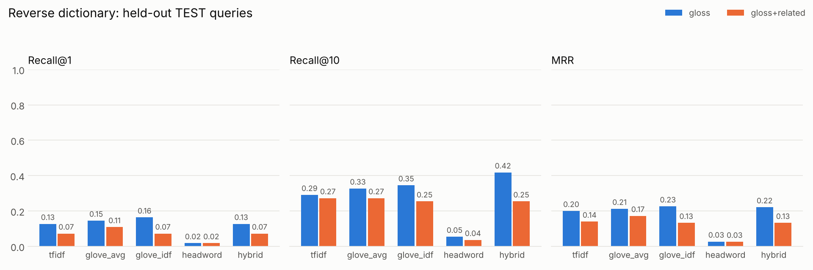

# Tip-of-the-Tongue Reverse Dictionary

Type a description, get the word: `"fear of heights"` → **acrophobia**,
`"someone who walks while asleep"` → **sleepwalker / somnambulist**.

It searches the ~75,000 meanings in WordNet and compares **four ways of matching** a
description to a definition, with a proper held-out evaluation:

| Method | Idea | Course topic |
|---|---|---|
| `tfidf` | cosine similarity of TF-IDF vectors (needs shared words) | Unit 2, TF-IDF; Exp 1, 5 |
| `glove_avg` | average of GloVe word vectors of the definition | Unit 2, dense vectors (GloVe) |
| `glove_idf` | same, rarer words weigh more (IDF-weighted average) | TF-IDF + GloVe combined |
| `headword` | compare the query with the candidate word's *own* GloVe vector | embeddings (a negative result, see below) |
| `hybrid` | Reciprocal Rank Fusion of the above, weights tuned on dev | rank fusion |

Pre-processing (tokenize → stop words → lemmatize, WordNet) comes from Unit 1 / Exp 3.
All code is plain functions; there are no classes.

## Run it

```bash
pip install -r requirements.txt

python search.py "fear of heights"                       # command line
python search.py "the meal you eat around noon" --explain  # shows WHY each word matched
streamlit run app.py                                     # web app (has a TF-IDF vs embeddings view)
python evaluate.py                                       # reproduces every number below (1-3 min)
pytest -q                                                # 13 tests
```

First run downloads WordNet (via NLTK) and GloVe-100d (~130 MB from the gensim-data GitHub
release) into `.cache/`, so it needs internet once. After that everything is local.

## Results

110 descriptions written by hand (`queries.csv`), each with one or more acceptable answers
(synonyms). They were split once, at random with a fixed seed, into 55 **dev** and 55 **test**.
The hybrid weights and the text mode were chosen on dev only; the numbers below are on **test**.

| Method | Recall@1 | Recall@5 | Recall@10 | MRR |
|---|---|---|---|---|
| tfidf | 0.13 | 0.25 | 0.29 | 0.201 |
| glove_avg | 0.15 | 0.29 | 0.33 | 0.212 |
| glove_idf | 0.16 | 0.27 | 0.35 | 0.226 |
| headword | 0.02 | 0.02 | 0.05 | 0.027 |
| **hybrid** (0.6 TF-IDF, 0.4 GloVe-IDF) | 0.13 | 0.29 | **0.42** | 0.221 |



**What the numbers say, honestly**
- The hybrid finds the right word in the top 10 for **42%** of unseen descriptions versus **29%**
  for TF-IDF. A paired bootstrap gives +0.127, 95% CI [+0.018, +0.236], so this gain is real
  (`results/significance.txt`).
- Hybrid vs. GloVe-IDF alone is **not** distinguishable with 55 queries (CI includes 0). I am not
  claiming it is better.
- Recall@1 is low for every method. This is a hard task: WordNet definitions are terse
  ("a midday meal") and people describe things differently ("the meal you eat around noon").
- Adding example sentences and parent concepts to each definition (`gloss+related`) made things
  **worse** for every method (see `results/metrics.csv`): more text, more noise.
- The `headword` idea (compare the query with the answer word's own vector) failed. It returns
  *topic* words: for "an animal that only eats plants" it gives `feed, meat, fish`, not `herbivore`.
  GloVe says what a word appears *near*, not what it *is*.

**Where embeddings win** (`results/wins_and_losses.md` lists all of them, with evidence):
"the meal you eat around noon": TF-IDF ranks *lunch* 38th. GloVe sees `noon ≈ midday` and
`eat ≈ meal` and ranks it 3rd. "a huge spinning storm over the sea": `storm ≈ cyclone`.
**Where TF-IDF wins**: when the wording matches, e.g. "a person who eats no meat" → *vegetarian*
(TF-IDF rank 2, embeddings rank 23, because they drift to `omnivore, meal`).
The hybrid exists because the two fail in different places.

## How it works

1. `wordnet_data.py`: every WordNet synset (one meaning) becomes a document: its words, part of
   speech, definition. Names ("Paris") and phrases are dropped.
2. `text_utils.py`: lowercase, drop stop words (but keep "no / not / without"), lemmatize.
3. `retrieval.py`: score every meaning against the query with the methods above, fuse ranks,
   then convert meanings to words (most common word of a meaning first). Words that are in your
   query are never returned.
4. `evaluate.py`: dev/test split, weight tuning on dev, metrics, bootstrap, chart, error analysis.

Design choices worth knowing:
- **GloVe vectors are mean-centered.** They share one big common direction that makes every word
  look similar to every other. Subtracting the average of the 50k most frequent words raised dev
  Recall@10 of the embedding methods from 0.46 to 0.49.
- **IDF-weighted averaging** beats plain averaging: "who", "person" and "thing" should not count
  as much as "bees" or "stars". (dev MRR 0.267 → 0.295; test 0.212 → 0.226)
- **Reciprocal Rank Fusion** merges *ranks*, not scores, because a TF-IDF cosine of 0.4 and a
  GloVe cosine of 0.4 do not mean the same thing.
- **Query words missing from every definition still count** in the embedding query (with maximum
  IDF) because GloVe knows them, which TF-IDF cannot use.

## Limitations (say these before the examiner does)
- 110 queries written by one author: small and not representative of all users. The test half
  has 55, so differences under ~0.1 are within noise.
- Queries were written from general knowledge before any results were seen, but I know roughly how
  dictionaries phrase things, so some wording overlaps with WordNet naturally.
- GloVe-100d is an old, small model. A sentence-embedding model (e.g. `all-MiniLM-L6-v2`) would
  very likely do better; this was not tested here, so no claim is made.
- It is a *ranking* tool, not a chatbot: it cannot ask follow-up questions, and
  "a doctor who treats children" does **not** return *pediatrician* (its WordNet definition is
  worded very differently).

## Resume bullet
> Built a reverse dictionary over 75k WordNet meanings comparing TF-IDF, GloVe and a rank-fusion
> hybrid; on 55 held-out hand-written queries the hybrid raised Recall@10 from 29% to 42% over
> TF-IDF (paired-bootstrap 95% CI [+2, +24] points); mean-centering GloVe and IDF-weighting
> improved dev recall; includes a Streamlit app, unit tests and error analysis.

## Files
```
search.py          command-line tool           app.py            Streamlit app
retrieval.py       the retrieval methods       evaluate.py       evaluation + report
wordnet_data.py    WordNet -> documents        text_utils.py     pre-processing
queries.csv        110 hand-written queries    test_retrieval.py tests
results/           metrics.csv, per_query_ranks.csv, metrics_test.png,
                   significance.txt, wins_and_losses.md, best_params.json
```
